# Pixel Art Transitions Lab

[日本語](README.md) | **English**

Eight screen (scene) transitions for pixel-art games that you can play and compare in the browser.
They reimplement the techniques from the SpriteCook article [“Pixel Art Screen Transitions”](https://www.spritecook.ai/blog/pixel-art-screen-transitions). The article uses Godot 4 shaders and GDScript; this version uses Canvas 2D and plain JavaScript.

### ▶ Play: https://kumi0708.github.io/pixel-art-transitions-lab/

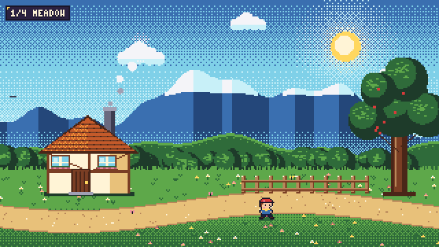

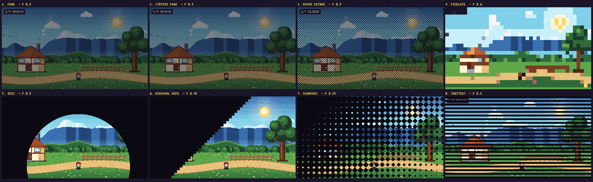

> Every figure in this README is generated from the same code as the game ([how](#figures)).

## Contents

- [How to play](#play)
- [The four rooms](#rooms)
- [How it works](#tech)
  - [1. Render pipeline](#pipeline)
  - [2. Shared timing](#timing)
  - [3. The eight transitions](#transitions): [Fade](#fade) · [Stepped](#stepped) · [Dither](#dither) · [Pixelate](#pixelate) · [Iris](#iris) · [Wipe](#wipe) · [Diamonds](#diamonds) · [Shutters](#shutters)
  - [4. Checking that no new colours appear](#verify)
  - [5. pixel_size: why the maths runs in game pixels](#pixel-size)
  - [6. How the art is made](#art)
  - [7. Porting notes](#porting)
- [Regenerating the figures](#figures)

---

<a id="play"></a>

## How to play

| Input | Action |
| --- | --- |
| ← → ↑ ↓ / WASD | Move the hero. Walk off the left/right edge to change rooms |
| Click / tap | Walk to that spot (tap near an edge to change rooms) |
| Space / Enter | Go to the next room |
| 1 – 8 | Switch transition style |
| Auto demo | The hero keeps walking right and tours the rooms |
| Speed | Slow down to 0.1× to study each step |
| Inspect | Pin `progress` with a slider, toggle `reverse`, click to move the iris centre |

The side panel shows `phase / tick / progress / reverse / paused` live, plus the **number of off-palette colours** and the **tick on which the player could first move again**.

It uses ES modules with no build step and no dependencies. To run it locally, serve the folder over HTTP, because ES modules don't load from `file://`:

```bash
python3 -m http.server 8000
```

```
index.html          UI (style picker, controls, timeline)
style.css
src/
  main.js           fixed 60 Hz loop, input, render pipeline, stats, ?sheet mode
  controller.js     shared 84-tick timing state machine
  transitions.js    the eight transitions as per-pixel functions
  scenes.js         four procedurally drawn pixel-art rooms
  art.js            32-colour palette, Bayer matrices, dither/shape helpers, 3×5 font, hero sprite
tools/
  figures.html/js   draws every figure in this README
  export_figures.py renders the figures in headless Chrome and saves PNG/GIF to docs/img/
```

<a id="rooms"></a>

## The four rooms

There are no image files: everything is drawn in code. Each room animates its own details: clouds, stars, smoke, flames, waves, a crab and more.

| 1. MEADOW | 2. NIGHT TOWN |
| --- | --- |
| 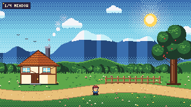 | 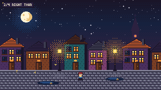 |
| **3. CRYSTAL CAVE** | **4. SUNSET SHORE** |
| 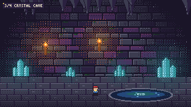 | 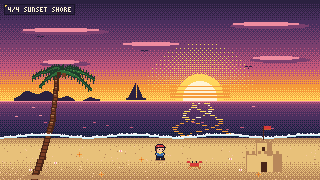 |

---

<a id="tech"></a>

## How it works

<a id="pipeline"></a>

### 1. Render pipeline

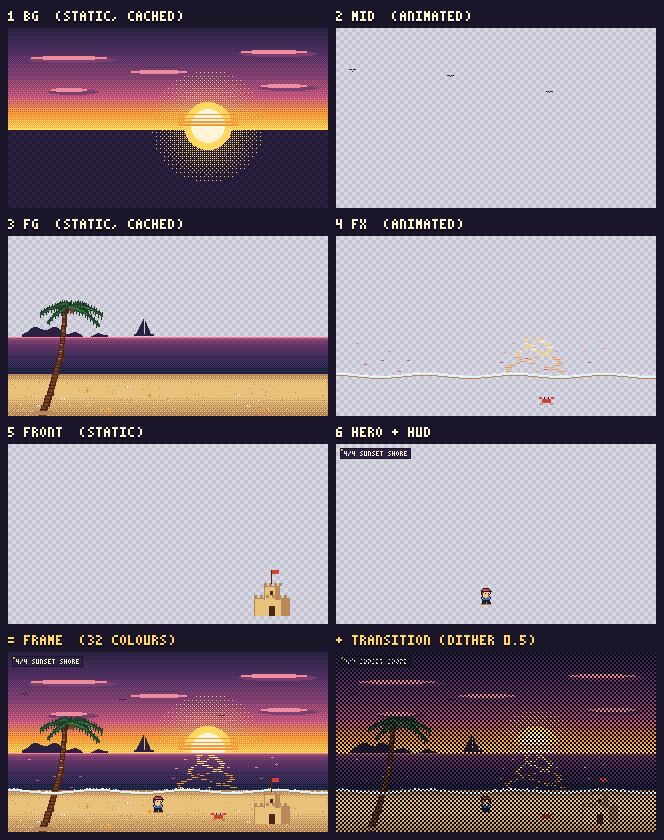

```
[bg canvas] → mid (animated) → [fg canvas] → fx (animated) → [front] → hero → HUD
        ↓ getImageData (320×180 game resolution)
   renderTransition(src, dst, progress, …)   ← the transition is composited here
        ↓ putImageData
   <canvas> scaled up with CSS (image-rendering: pixelated)
```

- **The game renders at a fixed 320×180.** Transitions are computed per game pixel, so the article's `pixel_size` (screen pixels per game pixel) is always 1 here. Upscaling happens last, in CSS. The scale is an **integer** (2×, 3×, …) when possible, and fractional only on screens too small for 2×.
- As the figure shows, the static layers (BG / FG / FRONT) are drawn once into off-screen canvases and cached. Only moving things (MID / FX / hero) are redrawn each frame.
- **The HUD (room label, top left) is drawn into the game buffer before the transition**, so the cover goes over the HUD too. This matches the article's "CanvasLayer 100, above the HUD".
- Pixelate reads the screen, so it has to run **after the whole frame is drawn**. The CPU version does this by using the finished `getImageData` frame as its source.

<a id="timing"></a>

### 2. Shared timing

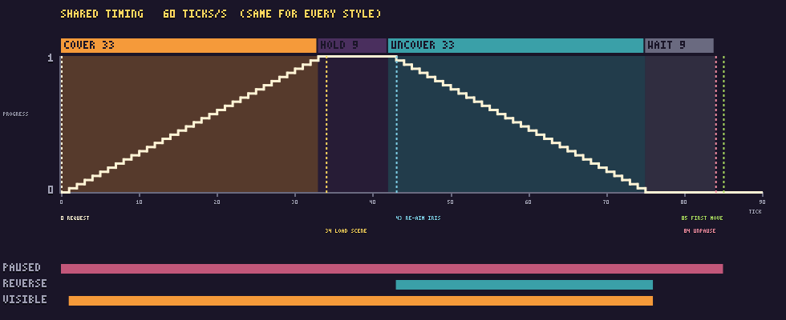

One state machine in `src/controller.js` drives the timing for every style. It runs on a fixed 60 ticks/s. The white staircase in the figure is `progress`. The bars underneath show when the game is `paused`, when `reverse` is set, and when the cover is visible.

| tick | phase | progress | what happens |
| --- | --- | --- | --- |
| 0 | request | 0 | transition requested, game paused |
| 1–33 | cover | k/33 | screen covered over 0.55 s |
| 34–42 | hold | 1 | **room swapped on tick 34**, hidden under full black |
| 43–75 | uncover | 1 − j/33 | `reverse = true`; tick 43 re-aims the iris at the hero in the new room |
| 76–84 | wait | 0 | cover hidden, still paused; tick 84 unpauses |
| 85 | — | — | **first tick the hero can move** |

- **Fixed timestep.** Elapsed `requestAnimationFrame` time goes into an accumulator, and `tick()` runs once per 1/60 s. The speed setting multiplies that accumulator, so at 0.25× the number of ticks (the number of visible steps) is unchanged.
- **Re-entry guard.** `request()` returns `false` and does nothing while a transition is running, so standing on the edge can't stack transitions.
- **Pause ordering.** `tick()` decides whether the game is paused from the state **before** the controller steps. So the unpause tick (84) is still a paused tick, and the first movement lands on **tick 85**, the same as Godot's physics order.
- **The room only swaps during full black.** Loading while the cover is still closing could make the transition look frozen halfway through.
- Ambient animation (clouds, flames, waves) keeps running. Only player input and movement are paused.

<a id="transitions"></a>

### 3. The eight transitions

Each style is a function of a game pixel `(x, y)` and `progress p`. It decides whether to output **the original colour or the cover colour** (the palette black `#0b0a12`) (`src/transitions.js`). Each one is a fragment-shader formula looped on the CPU over 320×180 = 57,600 pixels, so it ports straight back to a shader.

Each style comes with these figures:

- **Animation:** 84 ticks run through the real controller, one frame every 2 ticks.
- **Progress strip:** six stills from the cover phase.
- **Threshold map:** each pixel coloured by the progress at which it turns black. **Brighter turns black earlier; darker turns black later.** The right-hand panel zooms 9× into the white box. White lines mark the style's unit (block, stair, tile or band).

---

<a id="fade"></a>

#### ① Fade

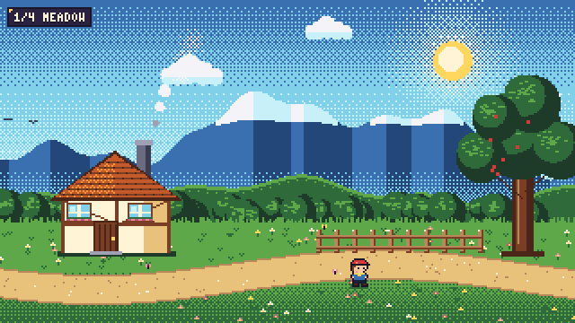

```js
out = round(src × (1 − p) + black × p)
```

Every pixel is blended linearly toward black. This is the only style that creates lots of off-palette colours, and it's here as a baseline. A single 33-tick fade-out in the meadow invents **815** new colours. The article's room had 751. [→ verification](#verify)

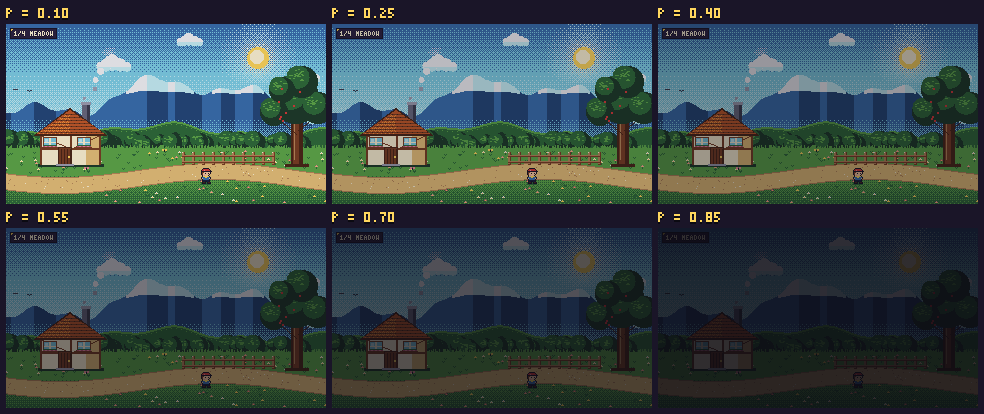

---

<a id="stepped"></a>

#### ② Stepped fade

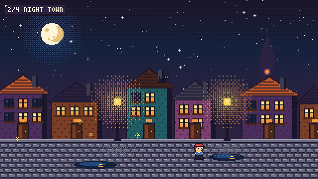

```js
a = floor(p × 4) / 4      // 0 → 25% → 50% → 75% → 100%
```

Alpha is quantised into 4 steps, each held for about 8 frames, which gives a chunky retro fade. Off-palette colours drop to **78**. The article measured 72.

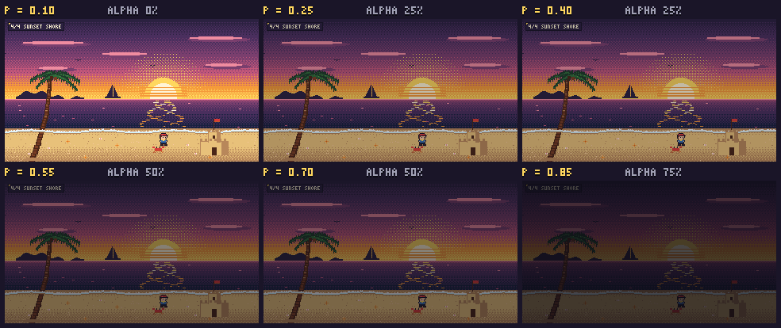

---

<a id="dither"></a>

#### ③ Bayer dither

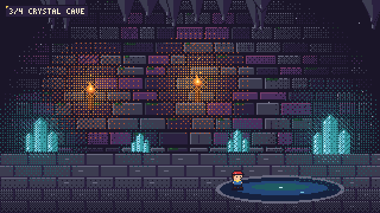

```js
b = floor(g / 2)                               // 2×2 game pixels per block
t = (BAYER8[(b.y % 8) * 8 + (b.x % 8)] + 0.5) / 64
black = p > t
```

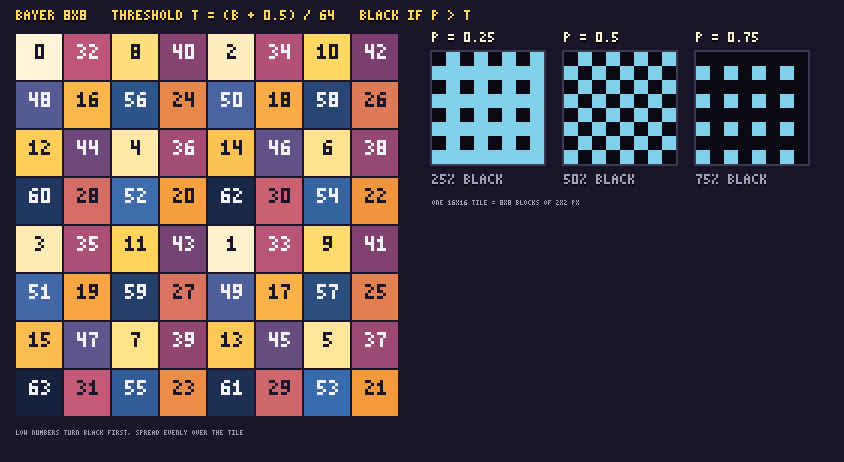

The standard 8×8 Bayer matrix (values 0–63) works as a threshold map. A block turns black once progress passes its threshold. The matrix is arranged so that small values spread evenly across the tile, so at any progress the black is evenly spread and forms a clean halftone. The `+0.5` puts the thresholds between 0.5/64 and 63.5/64, so p=0 is fully clear and p=1 is fully black.

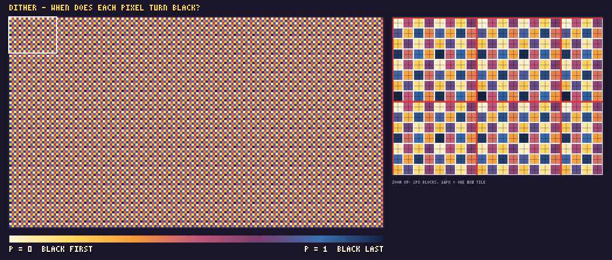

In the zoom, white lines are the 2-px blocks and red lines are the 16-px tiles (one full matrix of 8×8 blocks). Every pixel is either its original colour or black, so it creates **zero new colours**. The blocks are 2 px because a 1-px checkerboard shimmers when scaled up.

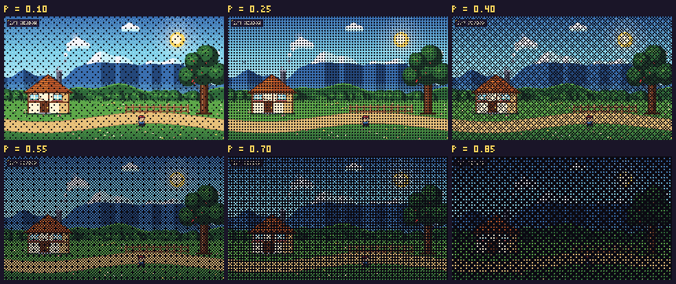

---

<a id="pixelate"></a>

#### ④ Pixelate

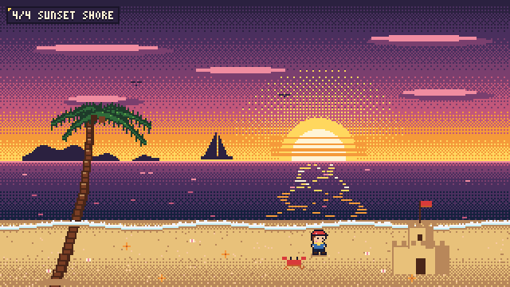

```js
k = floor(p × 6)
if (k >= 5) black
b = 2^k                                         // 1, 2, 4, 8, 16
src = min(floor(g / b) * b + floor(b / 2), size − 1)
```

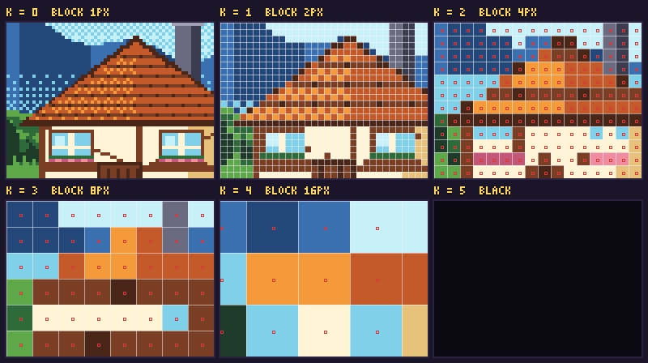

The block size doubles 1→2→4→8→16, and the last sixth of progress is solid black. Each stage covers one sixth of progress, about 5.5 ticks. **Each block copies its centre pixel** (the red squares).

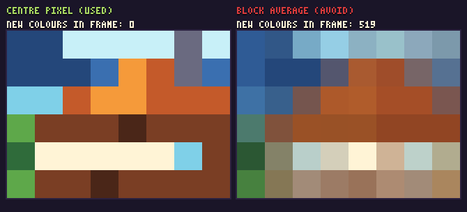

Averaging each block, as on the right, **creates 519 muddy colours that aren't in the palette**, which breaks the art. So it samples one point per block on purpose.

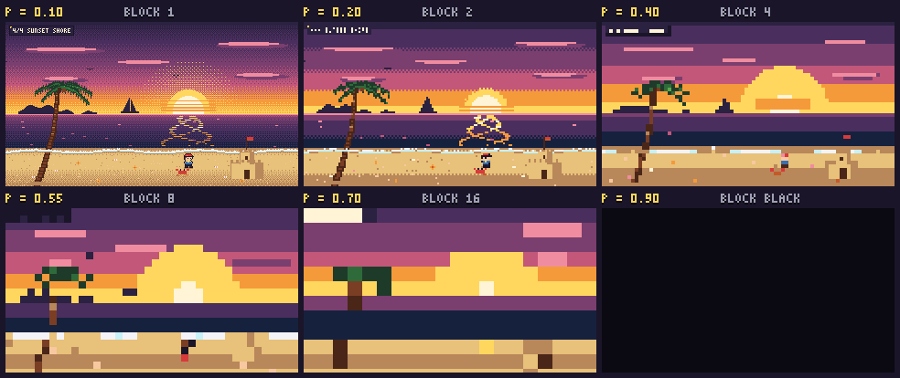

---

<a id="iris"></a>

#### ⑤ Iris


```js
r_max = max distance from the centre to the four corners
black = |(g + 0.5) − c| > (1 − p) × r_max
```

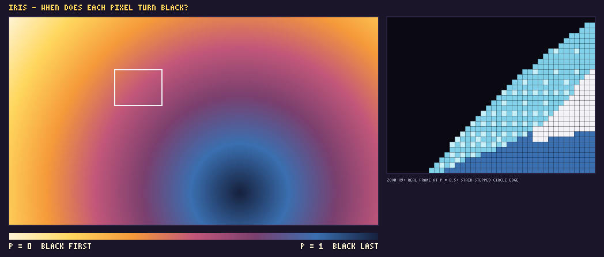

A circle closes on the hero. Using the distance to the farthest corner as `r_max` means p=0 always shows the whole screen, even when the centre is near an edge. The test runs at the pixel centre `g + 0.5`, and the circle's edge steps in whole game pixels (see the zoom).

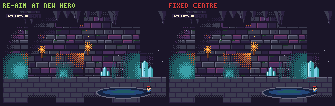

It closes on the hero in the old room, then **re-aims at the hero in the new room on tick 43**. On the left, the view opens from where the player appears. Without the re-aim, on the right, it opens on an empty spot.

---

<a id="wipe"></a>

#### ⑥ Diagonal wipe


```js
p' = floor(g / 6) * 6                           // snap to 6×6 stairs
w = (p'.x + p'.y + 6) / (W + H)                 // ≈0 top-left → ≈1 bottom-right
black = reverse ? (w > 1 − p) : (w < p)
```

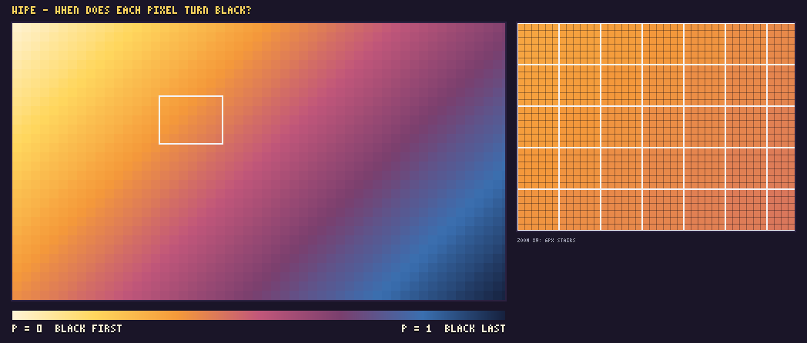

The pixel is snapped to a 6-px grid before its diagonal position `w` is computed, so the edge forms clean 6-px stairs. The white lines in the zoom are that grid.

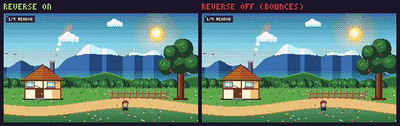

Playing the same formula backwards on the uncover phase makes the black "bounce" back the way it came, as on the right. The **`reverse` flag flips the test**, so the black leaves through the bottom right, as on the left.

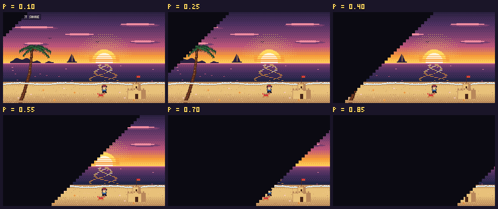

---

<a id="diamonds"></a>

#### ⑦ Diamonds


```js
cell  = floor((g + 0.5) / 12)
f     = ((g + 0.5) − cell × 12) / 12 − 0.5       // local coords −0.5..0.5
delay = (cell.x + cell.y) / max(cells.x + cells.y − 2, 1)
black = |f.x| + |f.y| < 2p − delay
```

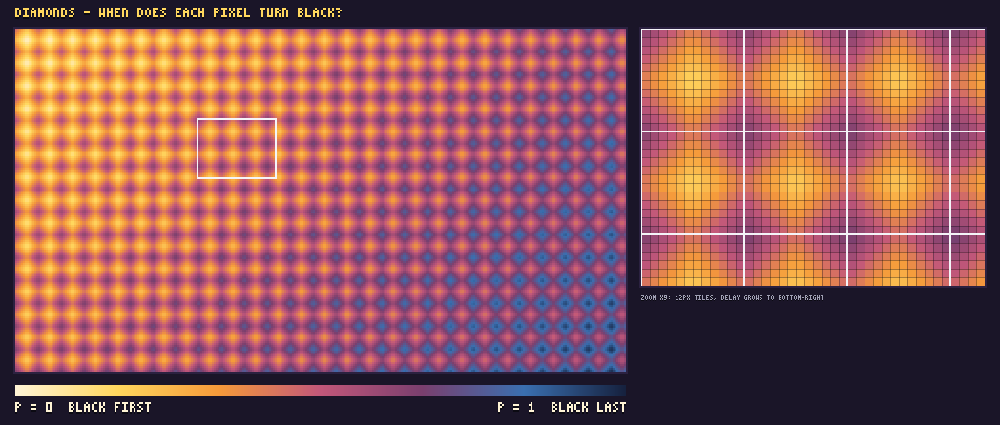

In each 12-px tile, the Manhattan distance `|f.x| + |f.y|` (a diamond) grows. In the threshold map, each tile's centre is bright (turns black early) and its corners are dark (late). The per-tile `delay` also darkens the whole map toward the bottom right, so the effect travels like a wave. At p=1 the bottom-right tile reaches a threshold of `2 − 1 = 1` and fills too.

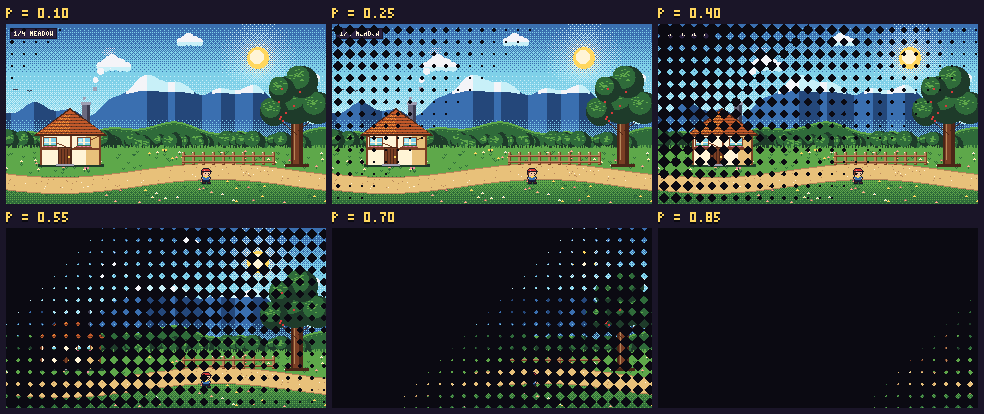

---

<a id="shutters"></a>

#### ⑧ Shutters


```js
black = (y mod 8) < p × 8
```

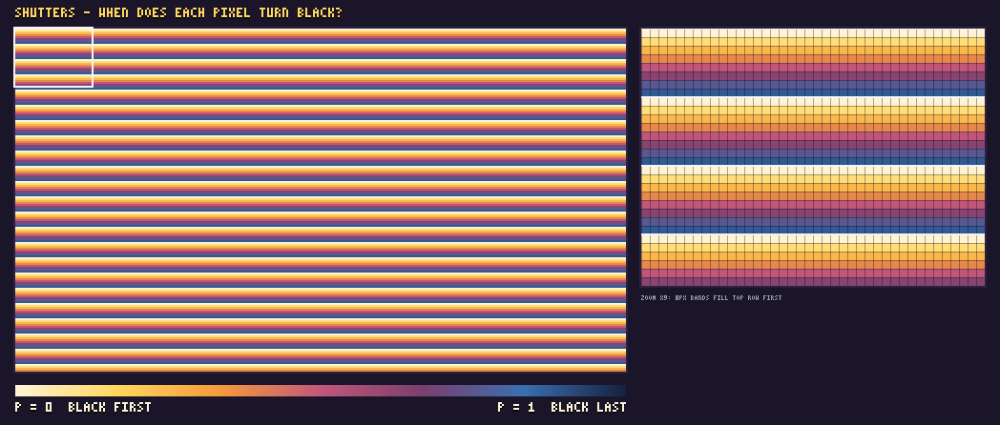

Every 8-px band fills from its top row down, one row at a time, like blinds closing. The test doesn't use x, so the threshold map is only horizontal stripes. Bigger bands mean fewer, heavier slats.

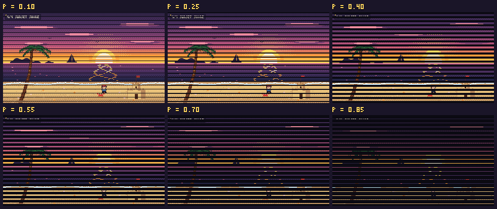

---

<a id="verify"></a>

### 4. Checking that no new colours appear

Every pixel of the game frame is drawn from the 32-colour palette below. Each frame, the demo counts the **colours in the output that aren't in the palette** with a `Set`. The app's side panel shows the count too.

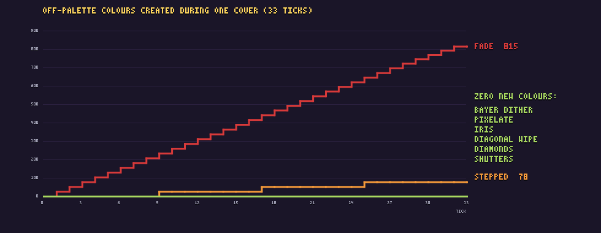

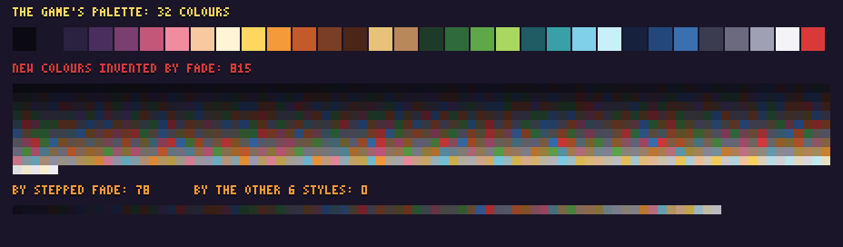

| Style | Off-palette colours (33-tick cover) |
| --- | --- |
| Fade | 815 |
| Stepped fade | 78 |
| Dither / Pixelate / Iris / Wipe / Diamonds / Shutters | **0** |

These were also checked in the browser:

- p=0 looks identical to no transition.
- The room swaps on tick 34.
- A second request while running returns `false`.
- The first move is on tick 85, whether the transition was requested from the button or by walking off the edge.

<a id="pixel-size"></a>

### 5. pixel_size: why the maths runs in game pixels

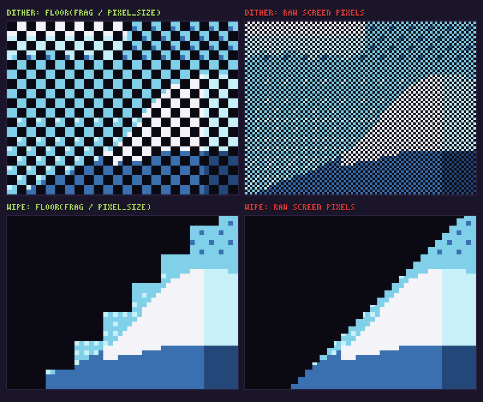

A GPU shader that runs at screen resolution must **first snap to game pixels** with `g = floor(FRAGCOORD.xy / pixel_size)`, as the article says. The right-hand column applies the same formulas to a 4× upscaled screen without that division:

- The dither checkerboard becomes finer than one game pixel, so it lays noise at a different resolution over the sprite art.
- The wipe's stairs no longer line up with the art's grid.

This demo applies transitions directly to the game-resolution buffer, so it always gets the left-hand result.

<a id="art"></a>

### 6. How the art is made

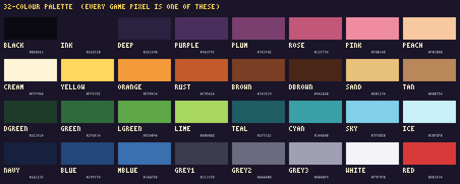

- **Fixed 32-colour palette** (`PAL`). Everything is drawn with integer-aligned `fillRect` and no anti-aliasing, so the buffer holds only palette colours. That's what makes the check above meaningful.
- **Seeded RNG** (mulberry32) places trees, stars and stones, so the scenes look the same on every load.

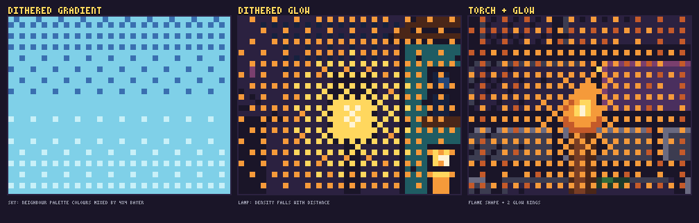

- **Dithered gradients.** Skies and the sea mix neighbouring palette colours with a 4×4 Bayer matrix, which gives smooth tones without adding colours (`gradient()`). Runs of the same colour are merged into one `fillRect` for speed (`ditherRow()`).
- **Dithered glows.** Street lamps, torches, crystals and the sun use `glow()`. It places palette-colour dots with a density that falls off with distance from the centre. Changing the radius a little each tick makes flames flicker.

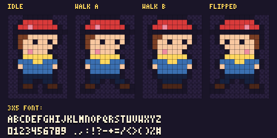

- The **12×16 hero sprite** is a string map, one character per pixel (for example `'.kRRwRRRRRk.'`). It has 2 walk frames plus idle, and flipping it just reads each row backwards.
- The **3×5 pixel font** is hand-made too. It draws the HUD and every label in these figures.

<a id="porting"></a>

### 7. Porting notes

- For Godot or Unity shaders, each `case` in `transitions.js` becomes a fragment-shader body. Convert coordinates to game pixels with `floor(FRAGCOORD.xy / pixel_size)` first.
- Unity's `SV_POSITION` starts at the bottom left on some platforms. If the wipe or shutters run upward, flip y.
- Pixelate needs a copy of the screen (Godot `hint_screen_texture`, Unity GrabPass or RenderTexture) with nearest sampling.
- If you change the 60 Hz tick rate, scale the 33/9/33/9 tick counts too, or the durations will change.

<a id="figures"></a>

## Regenerating the figures

`tools/figures.html` draws every figure here, using the same modules as the game (`src/*.js`). Open it in a browser to preview the figures. Headless Chrome and Pillow write them to files:

```bash
python3 -m http.server 8000
```

```bash
python3 tools/export_figures.py --url http://localhost:8000
```

To regenerate only some figures, pass `--only`, for example `--only anim,map`. Opening the game with `?sheet&scene=1` also renders an overview of all 8 styles.

## Credits

- The techniques, timing and formulas come from the SpriteCook article [“Pixel Art Screen Transitions”](https://www.spritecook.ai/blog/pixel-art-screen-transitions). The code here was written new for this repository.
- All art and figures are generated by the code in this repository.
