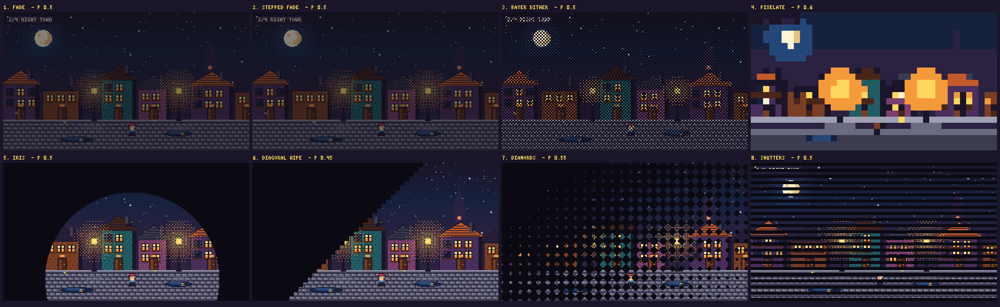

# Pixel Art Transitions Lab

**日本語** | [English](README.en.md)

ピクセルアートゲーム向けの画面遷移（シーントランジション）8種を、ブラウザ上で動かして比較できるデモです。
SpriteCook のブログ記事 [“Pixel Art Screen Transitions”](https://www.spritecook.ai/blog/pixel-art-screen-transitions) の手法（Godot 4 のシェーダー＋GDScript）を、Canvas 2D と素の JavaScript で再実装しました。

### ▶ プレイ: https://kumi0708.github.io/pixel-art-transitions-lab/




---

## 遊び方

| 操作 | 内容 |
| --- | --- |
| ← → ↑ ↓ / WASD | 勇者を移動。画面の左右端まで歩くと隣の部屋へ遷移 |
| クリック / タップ | その位置まで歩く（端をタップすると部屋移動） |
| Space / Enter | 次の部屋へ遷移 |
| 1 – 8 | トランジションのスタイル切替 |
| オートデモ | 勇者が自動で右へ歩き続け、部屋を巡回 |
| 速度 | 0.1× まで落としてコマ送り的に観察 |
| 手動検査 | progress をスライダーで固定。`reverse` の切替、クリックでアイリスの中心を移動 |

右パネルには `phase / tick / progress / reverse / paused`、**パレット外の色の数**、**遷移後に初めて動けた tick** がリアルタイムで表示されます。

部屋は 4 つです：**昼の草原 → 夜の街 → 水晶の洞窟 → 夕暮れの浜辺**。

## 構成

```
index.html          UI（スタイル選択・操作パネル・タイムライン）
style.css
src/
  main.js           60Hz 固定ループ、入力、描画パイプライン、統計、?sheet モード
  controller.js     全スタイル共通のタイミング・ステートマシン（84 tick）
  transitions.js    8 種のトランジション（ピクセル単位の判定関数）
  scenes.js         4 つの部屋のプロシージャルなピクセルアート
  art.js            32色パレット、ベイヤー行列、ディザ／図形ヘルパー、3×5 フォント、勇者スプライト
docs/               README 用の画像
```

ビルド不要・依存ライブラリなしの ES Modules です。ローカルで動かす場合は静的サーバーで配信してください（`file://` では ES Modules が読めません）。

```bash
python3 -m http.server 8000
```

`http://localhost:8000/?sheet&scene=1` を開くと、README の画像のような 8 スタイル一覧（コンタクトシート）が描かれます（`scene` は 0–3、`scale` で拡大率）。

---

## 技術解説

### 1. 描画パイプライン

```
[bg canvas] → mid(アニメ) → [fg canvas] → fx(アニメ) → [front] → 勇者 → HUD
        ↓ getImageData（320×180 のゲーム解像度）
   renderTransition(src, dst, progress, …)   ← ここでトランジションを合成
        ↓ putImageData
   <canvas> を CSS で整数倍に拡大（image-rendering: pixelated）
```

- **ゲーム解像度は 320×180 固定**。トランジションはゲーム側の 1 ピクセル単位で計算するので、記事でいう `pixel_size`（画面ピクセル ÷ ゲームピクセル）は常に 1 です。拡大は最後に CSS で行い、可能なら**整数倍**（2×, 3×, …）、2× 未満しか入らない小さい画面だけ非整数倍にしています。
  - GPU シェーダーで画面解像度のまま処理する場合は、記事の通り `g = floor(FRAGCOORD.xy / pixel_size)` で先にゲームピクセルへ落とさないと、ディザの市松模様やワイプの階段が 1 ゲームピクセルより細かくなってしまいます。
- **HUD（部屋名の表示）もゲームバッファに描いてから**トランジションを掛けるので、カバーは HUD の上にも乗ります（記事の「CanvasLayer 100 で HUD より上に描く」に相当）。
- ピクセレートは「画面を読む」タイプなので、**ゲーム画面を全部描き終わった後**に処理する必要があります。CPU 実装では `getImageData` した完成フレームをソースにすることでこれを満たしています。

### 2. 共通タイミング（`src/controller.js`）

スタイルが何であってもタイミングは 1 つのステートマシンで共通です。60 tick/秒の固定ステップで動きます。

| tick | フェーズ | progress | 処理 |
| --- | --- | --- | --- |
| 0 | request | 0 | 遷移要求。ゲームを一時停止 |
| 1–33 | cover | k/33 | 0.55 秒で画面を覆う |
| 34–42 | hold | 1 | **tick 34 で部屋を差し替え**（真っ黒で見えない） |
| 43–75 | uncover | 1 − j/33 | `reverse = true`。tick 43 でアイリスの中心を新しい部屋の勇者に再照準 |
| 76–84 | wait | 0 | カバー非表示、まだ停止中。tick 84 で停止解除 |
| 85 | — | — | **勇者が初めて動ける tick** |

実装上のポイント：

- **固定タイムステップ**：`requestAnimationFrame` の経過時間をアキュムレータに貯め、1/60 秒ごとに `tick()` を回します。速度スライダーはこのアキュムレータに掛かる倍率なので、0.25× でも tick 数（＝見た目の段数）は変わりません。
- **二重要求ガード**：`request()` は実行中なら `false` を返して何もしません（端で足踏みしても多重遷移しない）。
- **一時停止の順序**：`tick()` では「コントローラーを進める**前**の」アクティブ状態で停止判定をしています。これで停止解除の tick 84 自体はまだ停止扱いになり、Godot の物理処理順と同じく**初移動が tick 85** になります（パネルの「初移動 tick」で確認できます）。
- **シーンは真っ黒の間にだけ差し替え**ます。覆っている途中でロードすると、ロードのカクつきで遷移が途中で止まって見えるためです。
- 背景のアニメーション（雲・炎・波など）は止めず、**プレイヤーの入力と移動だけ**を止めています。

### 3. 8 つのトランジション（`src/transitions.js`）

全スタイルは「ゲームピクセル `(x, y)` と `progress p` から、**元の色をそのまま出すか、カバー色（パレットの黒 `#0b0a12`）を出すか**」を決める関数です。GPU のフラグメントシェーダーの式を、CPU で 320×180＝57,600 ピクセル分ループしているだけなので、そのままシェーダーに移植できます。

#### ① Fade（フェード）
```js
out = round(src × (1 − p) + black × p)
```
全ピクセルを黒へ線形補間。唯一「パレットに無い中間色」を大量に作るスタイルで、比較用のベースラインです。本デモの草原では、33 tick のフェードアウト 1 回で **815 色**のパレット外の色が発生しました（記事の部屋では 751 色）。

#### ② Stepped fade（段階フェード）
```js
a = floor(p × 4) / 4      // 0 → 25% → 50% → 75% → 100%
```
アルファを 4 段に量子化。各段が約 8 フレームずつ保持され、レトロ機らしい「カクッ、カクッ」とした暗転になります。中間色は **69 色**まで減りました（記事は 72 色）。

#### ③ Bayer dither（ベイヤーディザ）
```js
b = floor(g / 2)                               // 2×2 ゲームピクセルを 1 ブロックに
t = (BAYER8[(b.y % 8) * 8 + (b.x % 8)] + 0.5) / 64
black = p > t
```
標準の 8×8 ベイヤー行列（0–63）をしきい値マップにして、progress を超えたブロックから黒に置き換えます。各ピクセルは「元の色か黒」のどちらかなので、**新しい色は 0**。`+0.5` によりしきい値は 0.5/64 … 63.5/64 に分布し、p=0 では完全に透明、p=1 では完全に黒になります。ブロックを 2px にしているのは、1px の市松模様だと拡大時にちらついて見えるためです。

#### ④ Pixelate（ピクセレート）
```js
k = floor(p × 6)
if (k >= 5) black
b = 2^k                                         // 1, 2, 4, 8, 16
src = min(floor(g / b) * b + floor(b / 2), size − 1)
```
ブロックサイズを 1→2→4→8→16 と倍々にし、最後の 1/6 は真っ黒。**各ブロックはブロック中央の 1 ピクセルをコピー**します。平均を取ると混色が生まれてパレットが崩れるので、意図的に「代表点サンプリング」にしています。

#### ⑤ Iris（アイリス）
```js
r_max = 中心から4隅への距離の最大値
black = |(g + 0.5) − c| > (1 − p) × r_max
```
勇者を中心とした円が閉じていきます。閉じるときは旧部屋の勇者、**開くとき（tick 43）は新しい部屋の勇者に中心を付け替える**ので、出現位置から視界が広がります。r_max を「最も遠い角までの距離」にすることで、中心が端に寄っていても p=0 で必ず全画面が見えます。

#### ⑥ Diagonal wipe（斜めワイプ）
```js
p' = floor(g / 6) * 6                           // 6×6 の階段にスナップ
w = (p'.x + p'.y + 6) / (W + H)                 // 左上≈0 → 右下≈1
black = reverse ? (w > 1 − p) : (w < p)
```
6px 単位の階段状エッジで左上から右下へ黒が流れます。戻り（uncover）で同じ式を逆再生すると黒が来た方向へ「跳ね返る」ように見えるので、**`reverse` フラグで判定を反転**させ、黒が右下へ抜けていくようにしています。

#### ⑦ Diamonds（ダイヤ）
```js
cell  = floor((g + 0.5) / 12)
f     = ((g + 0.5) − cell × 12) / 12 − 0.5       // タイル内座標 −0.5..0.5
delay = (cell.x + cell.y) / max(cells.x + cells.y − 2, 1)
black = |f.x| + |f.y| < 2p − delay
```
12px タイルごとにマンハッタン距離（＝ひし形）が膨らみます。タイル位置に応じた `delay` により左上から右下へ波のように伝播し、p=1 で右下のタイルも `2 − 1 = 1` のしきい値になって全面が埋まります。

#### ⑧ Shutters（シャッター）
```js
black = (y mod 8) < p × 8
```
8px の帯ごとに上の行から 1 行ずつ黒くなる、ブラインド型。帯を太くすると枚数が減って重たい印象になります。

### 4. 「新しい色を作らない」ことの検証

ゲーム画面の全ピクセルは 32 色パレットのどれかになるように描いています（下記「アートの作り方」）。そのうえで毎フレーム、出力画像のうち**パレットに含まれない色**を `Set` で数えて表示しています。

| スタイル | パレット外の色 |
| --- | --- |
| Fade（33 tick の暗転） | 815 |
| Stepped fade（同） | 69 |
| Dither / Pixelate / Iris / Wipe / Diamonds / Shutters | **0**（p = 0, 0.3, 0.5, 0.8, 1 で確認） |

ほかに、ブラウザ上で次の点を確認しています：p=0 は遷移なしと同じ見た目、部屋の差し替えは tick 34、実行中の 2 回目の要求は `false`、初移動は tick 85（ボタンからの要求・画面端からの要求の両方）。

### 5. アートの作り方（`src/art.js`, `src/scenes.js`）

画像ファイルは一切使わず、すべてコードで描いています。

- **32 色の固定パレット**（`PAL`）。すべての描画は整数座標の `fillRect` で、アンチエイリアスは使いません。そのため描画後のバッファは厳密にパレット色だけになり、上の検証が成り立ちます。
- **ディザグラデーション**：空や海は 4×4 ベイヤー行列で隣り合う 2 色を混ぜて、パレットを増やさずに階調を出しています（`gradient()`）。同じ色が続く区間は 1 回の `fillRect` にまとめて高速化しています（`ditherRow()`）。
- **ディザ発光**：街灯・たいまつ・水晶・太陽の光は、中心からの距離に応じた密度でパレット色の点を打つ `glow()`。半径を毎 tick 揺らすと炎のゆらめきになります。
- **レイヤー分け**：静的な `bg` / `fg` / `front` はオフスクリーン Canvas に一度だけ描いてキャッシュし、雲・星・煙・波・カニなど動く物だけを毎フレーム描きます。
- **シード付き乱数**（mulberry32）で木・星・石の配置を生成しているので、毎回同じ絵になります。
- **3×5 ドットフォント**と **12×16 の勇者スプライト**（文字列マップ、歩行 2 コマ＋待機、左右反転）も自前です。

### 6. 他エンジンへの移植メモ

- Godot / Unity のシェーダーにする場合は、`transitions.js` の各 `case` がそのままフラグメントシェーダーの本体になります。座標は `floor(FRAGCOORD.xy / pixel_size)` でゲームピクセルに変換してから使ってください。
- Unity の `SV_POSITION` はプラットフォームによって原点が左下になるため、ワイプとシャッターが逆向きに動く場合は y を反転します。
- ピクセレートは画面のコピー（Godot の `hint_screen_texture`、Unity の GrabPass / RenderTexture）が必要で、サンプリングは nearest にします。
- tick レートを 60 から変える場合は、33/9/33/9 の tick 数もスケールしないと時間が変わります。

## クレジット

- 手法・タイミング・式は SpriteCook ブログ [“Pixel Art Screen Transitions”](https://www.spritecook.ai/blog/pixel-art-screen-transitions) を参考にしました。コードはこのリポジトリ用に新しく書いたものです。
- アートはすべてこのリポジトリ内のコードで生成しています。
