# Pixel Art Transitions Lab

**日本語** | [English](README.en.md)

ピクセルアートゲーム向けの画面遷移（シーントランジション）8種を、ブラウザ上で動かして比較できるデモです。
SpriteCook のブログ記事 [“Pixel Art Screen Transitions”](https://www.spritecook.ai/blog/pixel-art-screen-transitions) の手法（Godot 4 のシェーダー＋GDScript）を、Canvas 2D と素の JavaScript で再実装しました。

### ▶ プレイ: https://kumi0708.github.io/pixel-art-transitions-lab/

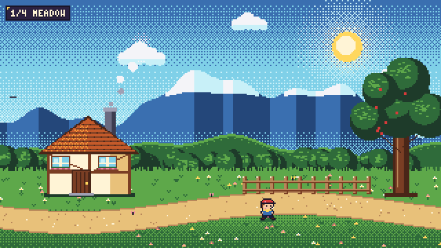

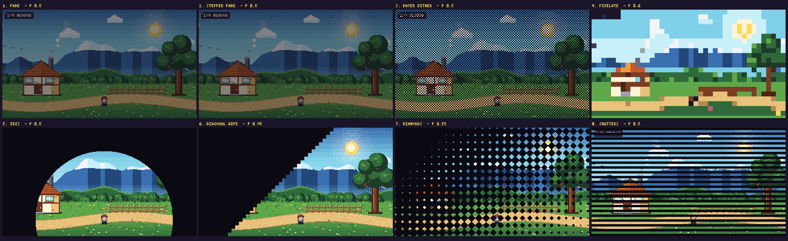

> この README の図はすべて、ゲーム本体と同じコードから自動生成しています（[図の作り方](#figures)）。

## 目次

- [遊び方](#play)
- [4つの部屋](#rooms)
- [技術解説](#tech)
  - [1. 描画パイプライン](#pipeline)
  - [2. 共通タイミング](#timing)
  - [3. 8つのトランジション](#transitions)：[Fade](#fade) · [Stepped](#stepped) · [Dither](#dither) · [Pixelate](#pixelate) · [Iris](#iris) · [Wipe](#wipe) · [Diamonds](#diamonds) · [Shutters](#shutters)
  - [4. 新しい色を作らないことの検証](#verify)
  - [5. pixel_size：ゲームピクセル単位で計算する理由](#pixel-size)
  - [6. アートの作り方](#art)
  - [7. 他エンジンへの移植メモ](#porting)
- [図の再生成](#figures)

---

<a id="play"></a>

## 遊び方

| 操作 | 内容 |
| --- | --- |
| ← → ↑ ↓ / WASD | 勇者を移動。画面の左右端まで歩くと隣の部屋へ遷移 |
| クリック / タップ | その位置まで歩く（端をタップすると部屋移動） |
| Space / Enter | 次の部屋へ遷移 |
| 1 – 8 | トランジションのスタイル切替 |
| オートデモ | 勇者が自動で右へ歩き続け、部屋を巡回 |
| 速度 | 0.1× まで落としてコマ送り的に観察 |
| 手動検査 | progress をスライダーで固定。`reverse` の切替、クリックでアイリスの中心を移動 |

右パネルには `phase / tick / progress / reverse / paused`、**パレット外の色の数**、**遷移後に初めて動けた tick** がリアルタイムで表示されます。

ビルド不要・依存ライブラリなしの ES Modules です。ローカルで動かす場合は静的サーバーで配信してください（`file://` では ES Modules が読めません）。

```bash
python3 -m http.server 8000
```

```
index.html          UI（スタイル選択・操作パネル・タイムライン）
style.css
src/
  main.js           60Hz 固定ループ、入力、描画パイプライン、統計、?sheet モード
  controller.js     全スタイル共通のタイミング・ステートマシン（84 tick）
  transitions.js    8 種のトランジション（ピクセル単位の判定関数）
  scenes.js         4 つの部屋のプロシージャルなピクセルアート
  art.js            32色パレット、ベイヤー行列、ディザ／図形ヘルパー、3×5 フォント、勇者スプライト
tools/
  figures.html/js   README の図をすべて描画するページ
  export_figures.py ヘッドレス Chrome で図を描き、docs/img/ に PNG/GIF として保存
```

<a id="rooms"></a>

## 4つの部屋

画像ファイルは使わず、すべてコードで描いています。部屋ごとに雲・星・煙・炎・波・カニなどが動きます。

| 1. 昼の草原 MEADOW | 2. 夜の街 NIGHT TOWN |
| --- | --- |
|  |  |
| **3. 水晶の洞窟 CRYSTAL CAVE** | **4. 夕暮れの浜辺 SUNSET SHORE** |
| 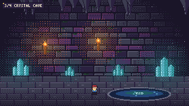 | 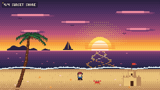 |

---

<a id="tech"></a>

## 技術解説

<a id="pipeline"></a>

### 1. 描画パイプライン

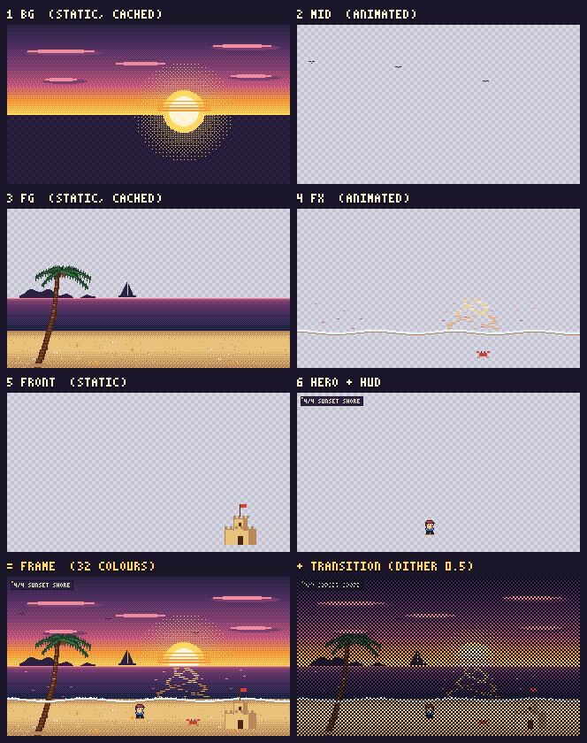

```
[bg canvas] → mid(アニメ) → [fg canvas] → fx(アニメ) → [front] → 勇者 → HUD
        ↓ getImageData（320×180 のゲーム解像度）
   renderTransition(src, dst, progress, …)   ← ここでトランジションを合成
        ↓ putImageData
   <canvas> を CSS で整数倍に拡大（image-rendering: pixelated）
```

- **ゲーム解像度は 320×180 固定**です。トランジションはゲームの 1 ピクセル単位で計算するので、記事でいう `pixel_size`（画面ピクセル ÷ ゲームピクセル）は常に 1 です。拡大は最後に CSS で行います。入るなら**整数倍**（2×, 3×, …）、2× 未満しか入らない小さい画面だけ非整数倍にしています。
- 上の図のように、静的なレイヤー（BG / FG / FRONT）は起動時に一度だけオフスクリーン Canvas に描いてキャッシュします。毎フレーム描くのは動くもの（MID / FX / 勇者）だけです。
- **HUD（左上の部屋名）もゲームバッファに描いてから**トランジションを掛けます。そのためカバーは HUD の上にも乗ります（記事の「CanvasLayer 100 で HUD より上に描く」に相当）。
- ピクセレートは「画面を読む」タイプなので、**フレームを全部描き終わった後**に処理する必要があります。CPU 実装では、完成フレームを `getImageData` で取得してソースにすることでこれを満たしています。

<a id="timing"></a>

### 2. 共通タイミング


スタイルが何であっても、タイミングは `src/controller.js` の 1 つのステートマシンで共通です。60 tick/秒の固定ステップで動きます。図の白い階段線が `progress`、下の帯は `paused`・`reverse`・カバーが見えている期間です。

| tick | フェーズ | progress | 処理 |
| --- | --- | --- | --- |
| 0 | request | 0 | 遷移要求。ゲームを一時停止 |
| 1–33 | cover | k/33 | 0.55 秒で画面を覆う |
| 34–42 | hold | 1 | **tick 34 で部屋を差し替え**（真っ黒で見えない） |
| 43–75 | uncover | 1 − j/33 | `reverse = true`。tick 43 でアイリスの中心を新しい部屋の勇者に合わせ直す |
| 76–84 | wait | 0 | カバー非表示、まだ停止中。tick 84 で停止解除 |
| 85 | — | — | **勇者が初めて動ける tick** |

- **固定タイムステップ**：`requestAnimationFrame` の経過時間をアキュムレータに貯め、1/60 秒ごとに `tick()` を回します。速度スライダーはアキュムレータに掛かる倍率なので、0.25× でも tick 数（＝見た目の段数）は変わりません。
- **二重要求ガード**：`request()` は実行中なら `false` を返して何もしません。端で足踏みしても遷移が重なりません。
- **一時停止の順序**：`tick()` は「コントローラーを進める**前**の」状態で停止中かどうかを判定します。停止解除の tick 84 自体はまだ停止扱いになるので、Godot の物理処理の順序と同じく**初移動は tick 85** になります。
- **シーンの差し替えは真っ黒の間だけ**です。覆っている途中でロードすると、ロードのカクつきで遷移が途中で止まって見えるためです。
- 背景のアニメーション（雲・炎・波など）は止めず、**プレイヤーの入力と移動だけ**を止めています。

<a id="transitions"></a>

### 3. 8つのトランジション

全スタイルは「ゲームピクセル `(x, y)` と `progress p` から、**元の色をそのまま出すか、カバー色（パレットの黒 `#0b0a12`）を出すか**を決める関数」です（`src/transitions.js`）。GPU のフラグメントシェーダーの式を、CPU で 320×180＝57,600 ピクセル分ループしているだけなので、そのままシェーダーに移植できます。

各スタイルには次の図を付けています。

- **アニメーション**：実際のコントローラーで 84 tick を回したもの（2 tick ごとに 1 コマ）。
- **progress ごとの静止画**：覆う途中を 6 段階で切り出したもの。
- **しきい値マップ**：「各ピクセルが progress いくつで黒くなるか」を色で塗った図。**明るい色ほど早く、暗い色ほど遅く**黒になります。右側は白枠の範囲を 9 倍に拡大したもので、白い線はスタイルの単位（ブロック・階段・タイル・帯）の境界です。

---

<a id="fade"></a>

#### ① Fade


```js
out = round(src × (1 − p) + black × p)
```

全ピクセルを黒へ線形補間します。唯一「パレットに無い中間色」を大量に作るスタイルで、比較用のベースラインです。草原の 33 tick の暗転だけで **815 色**の新しい色が生まれます（記事の部屋では 751 色）。[→ 検証](#verify)

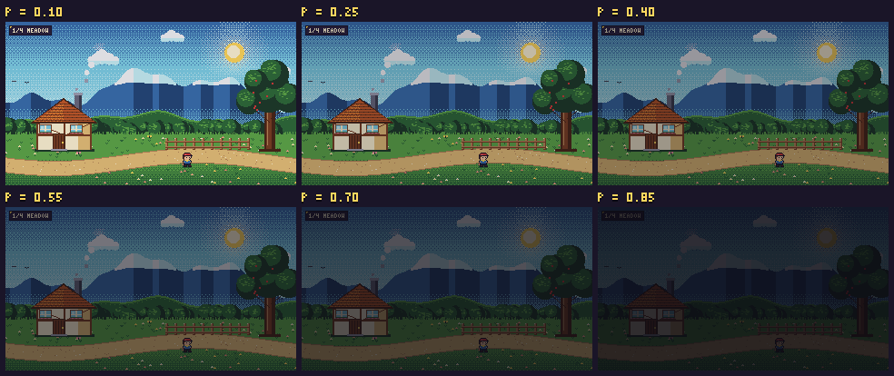

---

<a id="stepped"></a>

#### ② Stepped fade


```js
a = floor(p × 4) / 4      // 0 → 25% → 50% → 75% → 100%
```

アルファを 4 段に量子化します。各段が約 8 フレームずつ止まるので、レトロ機らしい「カクッ、カクッ」とした暗転になります。中間色は **78 色**まで減ります（記事は 72 色）。


---

<a id="dither"></a>

#### ③ Bayer dither

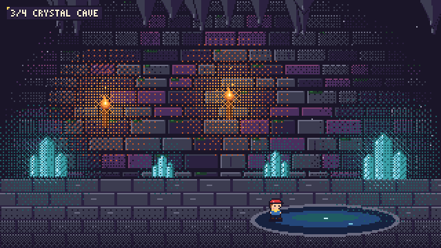

```js
b = floor(g / 2)                               // 2×2 ゲームピクセルを 1 ブロックに
t = (BAYER8[(b.y % 8) * 8 + (b.x % 8)] + 0.5) / 64
black = p > t
```

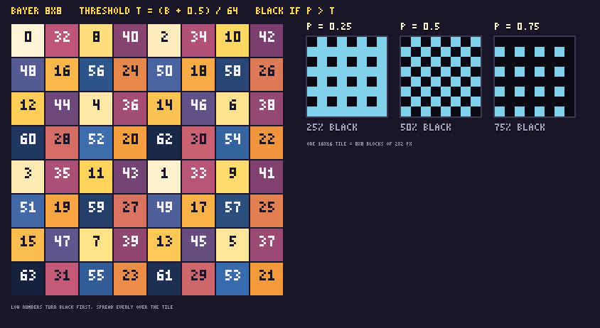

標準の 8×8 ベイヤー行列（0–63）をしきい値マップにして、progress を超えたブロックから黒に置き換えます。行列は「小さい数ほどタイル全体に均等に散らばる」ように並んでいるので、どの progress でも黒が偏らず、きれいな網点になります。`+0.5` によりしきい値は 0.5/64 … 63.5/64 に分布します。そのため p=0 では完全に透明、p=1 では完全に黒です。

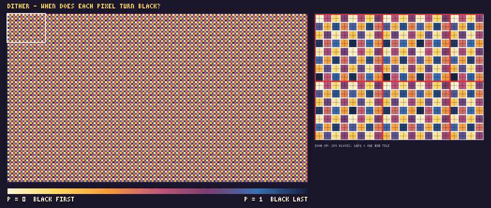

拡大図の白線が 2px ブロック、赤線が 16px（行列 1 枚＝8×8 ブロック）の境界です。各ピクセルは「元の色か黒」のどちらかなので、**新しい色は 0**。1px 単位ではなく 2px ブロックにしているのは、1px の市松模様だと拡大したときにちらついて見えるためです。


---

<a id="pixelate"></a>

#### ④ Pixelate

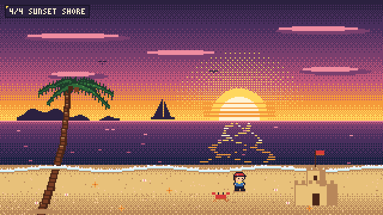

```js
k = floor(p × 6)
if (k >= 5) black
b = 2^k                                         // 1, 2, 4, 8, 16
src = min(floor(g / b) * b + floor(b / 2), size − 1)
```


ブロックサイズを 1→2→4→8→16 と倍々にし、最後の 1/6 は真っ黒にします。progress を 6 等分した区間ごとに段が切り替わるので、1 段は約 5.5 tick です。**各ブロックはブロック中央の 1 ピクセル（図の赤枠）をコピー**します。


ブロックの平均を取ると、上の右図のように**パレットに無い濁った色が 519 色も生まれ**、ピクセルアートの色が崩れます。そこで意図的に「代表点サンプリング」にしています。

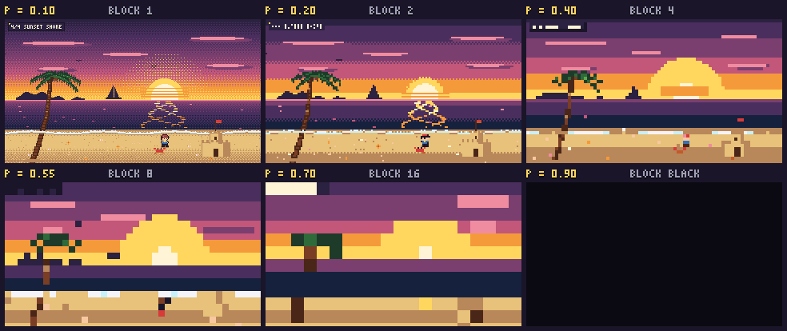

---

<a id="iris"></a>

#### ⑤ Iris

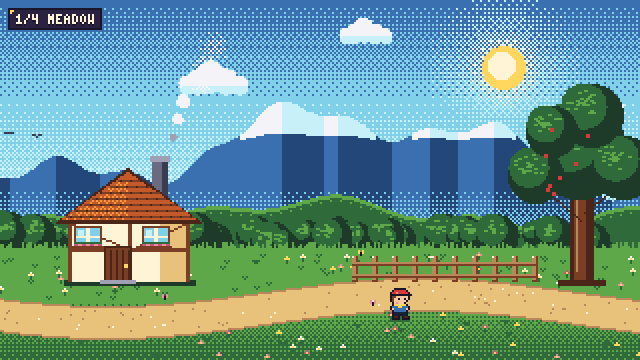

```js
r_max = 中心から4隅への距離の最大値
black = |(g + 0.5) − c| > (1 − p) × r_max
```


勇者を中心とした円が閉じていきます。r_max を「最も遠い角までの距離」にしているので、中心が端に寄っていても p=0 では必ず全画面が見えます。判定はピクセル中心 `g + 0.5` で行い、円の縁はゲームピクセル単位の階段になります（拡大図）。


閉じるときは旧部屋の勇者、**開くとき（tick 43）は新しい部屋の勇者に中心を付け替えます**。左のように、新しい出現位置から視界が広がります。付け替えないと右のように、勇者のいない場所から開いてしまいます。

---

<a id="wipe"></a>

#### ⑥ Diagonal wipe

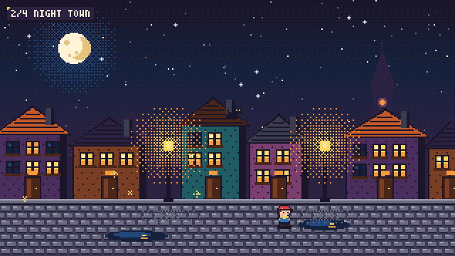

```js
p' = floor(g / 6) * 6                           // 6×6 の階段にスナップ
w = (p'.x + p'.y + 6) / (W + H)                 // 左上≈0 → 右下≈1
black = reverse ? (w > 1 − p) : (w < p)
```

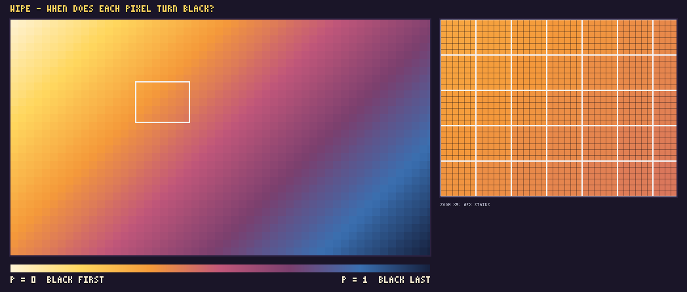

座標を 6px 単位にスナップしてから対角線方向の位置 `w` を求めるので、エッジがきれいな 6px の階段になります（拡大図の白線が 6px グリッド）。

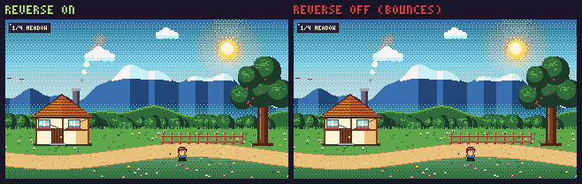

戻り（uncover）で同じ式を逆再生すると、右のように黒が来た方向へ「跳ね返る」ように見えます。**`reverse` フラグで判定を反転**させ、左のように黒が右下へ抜けていくようにしています。

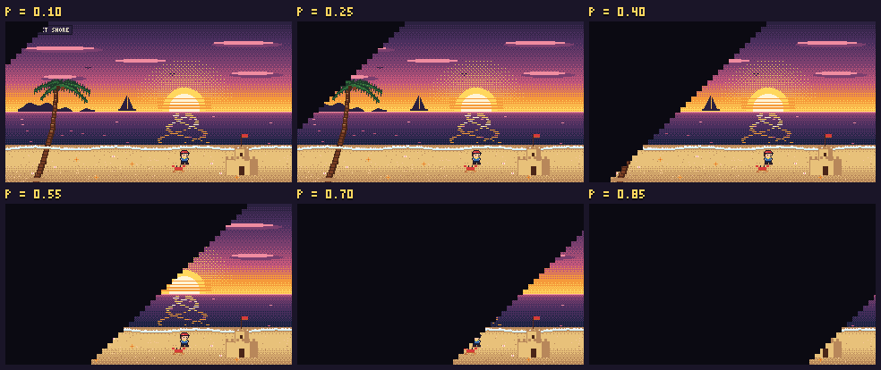

---

<a id="diamonds"></a>

#### ⑦ Diamonds


```js
cell  = floor((g + 0.5) / 12)
f     = ((g + 0.5) − cell × 12) / 12 − 0.5       // タイル内座標 −0.5..0.5
delay = (cell.x + cell.y) / max(cells.x + cells.y − 2, 1)
black = |f.x| + |f.y| < 2p − delay
```

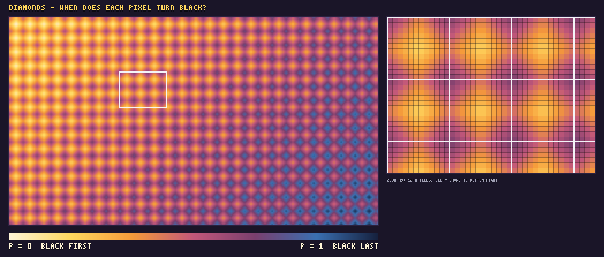

12px タイルごとにマンハッタン距離 `|f.x| + |f.y|`（＝ひし形）が膨らみます。しきい値マップでは、各タイルの中心が明るく（早く黒くなる）、角が暗く（遅い）なっています。さらに、タイル位置に応じた `delay` で全体が右下ほど暗くなり、波のように伝播します。p=1 では右下のタイルもしきい値 `2 − 1 = 1` になり、全面が埋まります。

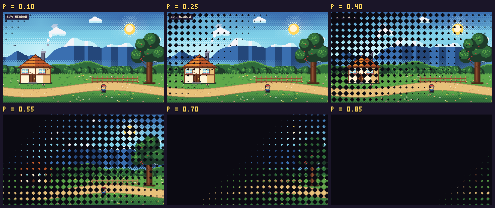

---

<a id="shutters"></a>

#### ⑧ Shutters


```js
black = (y mod 8) < p × 8
```


8px の帯ごとに、上の行から 1 行ずつ黒くなるブラインド型です。x に依存しないので、しきい値マップは横縞だけになります。帯を太くすると枚数が減って重たい印象になります。

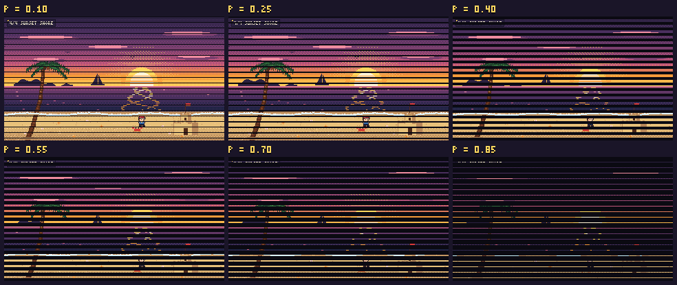

---

<a id="verify"></a>

### 4. 新しい色を作らないことの検証

ゲーム画面の全ピクセルは、下の 32 色パレットのどれかになるように描いています。そのうえで毎フレーム、出力画像のうち**パレットに含まれない色**を `Set` で数えています（アプリの右パネルにも表示されます）。


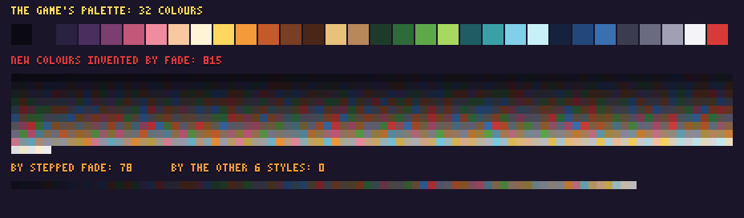

| スタイル | パレット外の色（33 tick の暗転） |
| --- | --- |
| Fade | 815 |
| Stepped fade | 78 |
| Dither / Pixelate / Iris / Wipe / Diamonds / Shutters | **0** |

ほかにブラウザ上で次の点を確認しています。

- p=0 は遷移なしと同じ見た目になる
- 部屋の差し替えは tick 34
- 実行中の 2 回目の要求は `false` が返る
- 初移動は tick 85（ボタンからの要求・画面端からの要求の両方）

<a id="pixel-size"></a>

### 5. pixel_size：ゲームピクセル単位で計算する理由

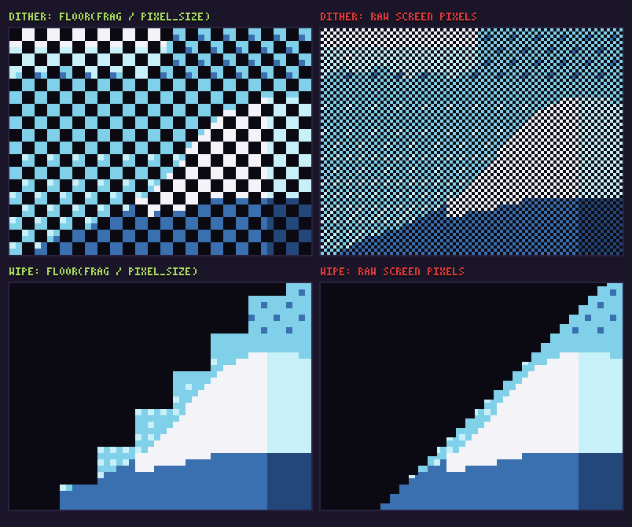

GPU シェーダーで画面解像度のまま処理する場合、記事の通り `g = floor(FRAGCOORD.xy / pixel_size)` で**先にゲームピクセルへ落とす**必要があります。右の列は 4 倍拡大した画面に、割り算をせずに同じ式を当てたものです。

- ディザの市松模様が 1 ゲームピクセルより細かくなり、ドット絵の上に別解像度のノイズが乗ってしまいます。
- ワイプの階段がアートの格子とずれます。

本デモはゲーム解像度のバッファに直接掛けるので、常に左側の結果になります。

<a id="art"></a>

### 6. アートの作り方


- **32 色の固定パレット**（`PAL`）を使います。すべての描画は整数座標の `fillRect` で行い、アンチエイリアスは使いません。そのため描画後のバッファは厳密にパレット色だけになり、上の検証が成り立ちます。
- **シード付き乱数**（mulberry32）で木・星・石の配置を生成しているので、毎回同じ絵になります。

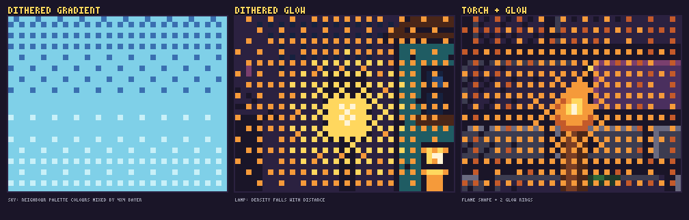

- **ディザグラデーション**：空や海は、隣り合うパレット色を 4×4 ベイヤー行列で混ぜて階調を出しています（`gradient()`）。パレットの色数は増やしていません。同じ色が続く区間は 1 回の `fillRect` にまとめて高速化しています（`ditherRow()`）。
- **ディザ発光**：街灯・たいまつ・水晶・太陽の光は `glow()` で描いています。中心からの距離に応じた密度でパレット色の点を打つ関数です。半径を毎 tick 少し揺らすと、炎のゆらめきになります。


- **12×16 の勇者スプライト**は文字列マップで定義しています（`'.kRRwRRRRRk.'` のように 1 文字 = 1 ピクセル）。歩行 2 コマと待機があり、左右反転は読み出す列を逆にするだけです。
- **3×5 ドットフォント**も自前です。HUD やこの README の図のラベルはすべてこのフォントで描いています。

<a id="porting"></a>

### 7. 他エンジンへの移植メモ

- Godot / Unity のシェーダーにする場合は、`transitions.js` の各 `case` がそのままフラグメントシェーダーの本体になります。座標は `floor(FRAGCOORD.xy / pixel_size)` でゲームピクセルに変換してから使ってください。
- Unity の `SV_POSITION` はプラットフォームによって原点が左下になります。ワイプとシャッターが逆向きに動く場合は y を反転してください。
- ピクセレートには画面のコピーが必要です（Godot の `hint_screen_texture`、Unity の GrabPass / RenderTexture）。サンプリングは nearest にします。
- tick レートを 60 から変える場合は、33/9/33/9 の tick 数もスケールしないと時間が変わります。

<a id="figures"></a>

## 図の再生成

README の図は `tools/figures.html` がゲームと同じモジュール（`src/*.js`）を読み込んで描いています。ブラウザで開けばその場でプレビューできます。ファイルへの書き出しはヘッドレス Chrome と Pillow で行います。

```bash
python3 -m http.server 8000
```

```bash
python3 tools/export_figures.py --url http://localhost:8000
```

`--only anim,map` のように一部だけ再生成することもできます。また、ゲーム本体の `?sheet&scene=1` を開くと、8 スタイルの一覧画像を描画します。

## クレジット

- 手法・タイミング・式は SpriteCook ブログ [“Pixel Art Screen Transitions”](https://www.spritecook.ai/blog/pixel-art-screen-transitions) を参考にしました。コードはこのリポジトリ用に新しく書いたものです。
- アートと図はすべてこのリポジトリ内のコードで生成しています。
